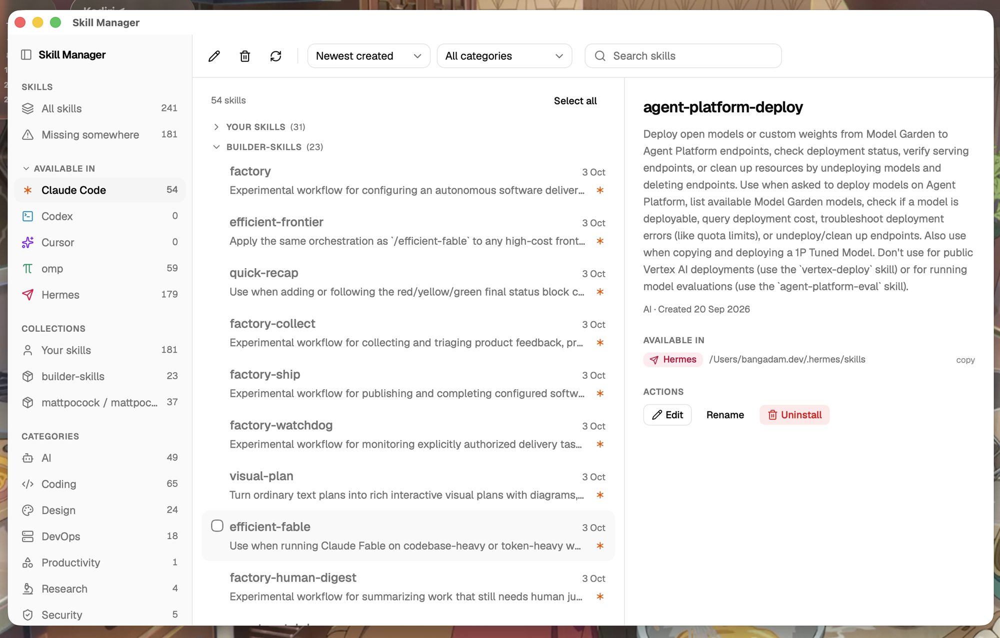

<div align="center">

# Skill Manager

**Every agent's skills. One list. One file per skill.**

A macOS desktop app that unifies skill management across [Claude Code](https://claude.com/claude-code), [Codex](https://openai.com/codex), [Cursor](https://cursor.com), and [omp](https://github.com/gaypuri/omp).



[Features](#features) · [How it works](#how-it-works) · [Install](#install) · [Development](#development)

</div>

---

## The problem

Every AI coding agent loads skills from its own folder. The same skills end up as separate copies scattered across those folders — editing means fixing every copy by hand, uninstalling means hunting directories, and plugin or built-in skills are invisible entirely.

## The fix

Skill Manager shows every skill from every agent in one list and makes **one physical file serve all of them**: linking a skill into another agent creates a symlink to the skill's master copy, so edits, renames, and uninstalls apply everywhere by construction.

## Features

- **Unified list** — every skill from all configured agent roots, with agent icons showing who loads what, grouped by source (your skills, plugin repos, agent built-ins) in collapsible sections.
- **Missing view** — skills that at least one agent can't see, with a one-click "link everywhere" to close the gap.
- **Duplicates view** — pairs text-similar copies so drift is found without AI.
- **Divergence guard** — linking, editing, or replacing onto a divergent copy is refused until you resolve a side-by-side diff; replacements always move the old copy to the Trash first.
- **In-app editor** — edit `SKILL.md` right in the app; identical copies stay identical.
- **Rename once** — renames the folder, relinks every link, and updates the frontmatter name.
- **Safe uninstall** — removes links first, then moves the master copy to the macOS Trash. Nothing is ever silently deleted.
- **Read-only managed skills** — plugin and built-in skills are listed with their source and can be uninstalled from the agent's cache (with a re-sync warning).
- **Live updates** — a filesystem watcher rescans and refreshes the UI as folders change on disk.
- **Disk is the source of truth** — every launch re-scans; no database, nothing persisted except a roots config and a rename journal.

## How it works

Three layers:

- A **Rust core crate** — all scanning, comparison, linking, renaming, editing, and uninstall logic, tested against temp-dir fixtures.
- A **Tauri 2 command layer** — wraps the core's public API one-to-one.
- A **React UI** — a thin view over those commands; it holds no filesystem logic.

Extra roots (a second Codex folder, an externally synced Cursor folder) are added via a plain JSON config file — no code changes needed.

## Install

Personal build for macOS (Apple Silicon):

```sh
git clone https://github.com/bangadam/skillmanager.git
cd skillmanager
pnpm tauri build
```

Drag the built app from `target/release/bundle/macos/` into `/Applications`. Unsigned — macOS will ask you to approve it on first launch.

## Development

```sh
pnpm install
pnpm tauri dev
```

Run the Rust core tests (the project's only test target — the UI is not tested):

```sh
cargo test --manifest-path core/Cargo.toml
```

## License

Personal project — not currently licensed for reuse.

